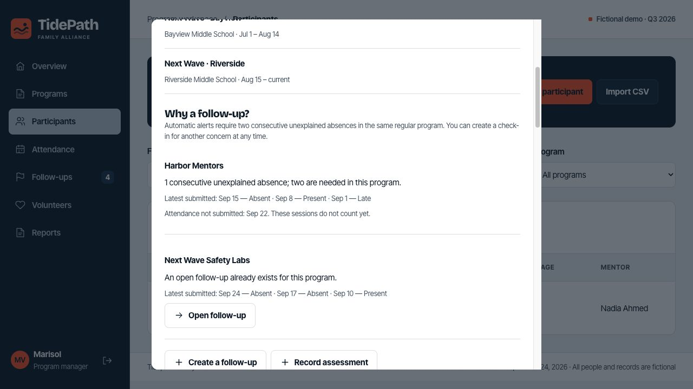

# TidePath


**Record once. Know who needs a call. Draft weekly and quarterly reports.**

TidePath is a program management app demonstrated with **Tidepath Family Alliance, a fictional youth nonprofit**. It connects family registration, attendance, mentors, volunteer hours, family follow-ups and quarterly reporting in one workspace. All demonstration records are made up.

[Open the working app](https://tidepath-demo.go-610.workers.dev/) · [Explore the Programs website](https://digismart-io.github.io/TidePath/) · [Read the submission overview](docs/SUBMISSION.md)

> Hackathon prototype with fictional records only. The complete application is on `main`. Shared demo accounts are for exploration with invented data.

## What it does

| Program management need | App feature |
| --- | --- |
| Retyping family signups across lists | One family form, multiple children, connected household and enrollment records |
| The same guardian appears under different names | CSV preview suggests possible matches; a manager confirms identities before import |
| Paper attendance arrives too late | Session leaders mark students on their phones and click **Submit attendance** once |
| Missed sessions go unnoticed | Two consecutive unexplained absences in the same regular program create an assigned follow-up |
| Staff see a concern outside the automatic rule | Manual follow-ups with a reason, owner, due date and next action |
| Mentor lists and volunteer hours are separate | Mentor assignment history and approved volunteer contributions share the same records |
| Quarter-end numbers do not agree | Computed metrics, source-record drill-down, assessment entry, narrative drafting and printable reports |

The opening weekly brief links families needing contact, attendance to finish, missing end responses and pending volunteer hours to their next actions and owners. A daily check refreshes in-app reminders. **Close the quarter** guides review and saves a dated, frozen report version with evidence and disclosed gaps.

Each participant’s **Why a follow-up?** section explains their submitted attendance, unsubmitted sessions and existing tasks. No manager approval is needed for attendance: submission immediately updates follow-up rules and report totals. Optional family events do not trigger absence alerts.

<details>
<summary>See the follow-up explanation screen</summary>



Fictional demonstration activity; the shared live data may change during testing.

</details>

## Try it

Choose a role on the [sign-in screen](https://tidepath-demo.go-610.workers.dev/), then click **Sign in**. Every demo account uses `TidePath-demo-2026!`.

| Account | Role | Access |
| --- | --- | --- |
| `marisol@tidepath.example` | Demo manager | Families, participants, imports, all sessions, follow-ups, mentors, hours, assessments and reports |
| `elena@tidepath.example` | Session leader | Harbor Mentors at Bayview |
| `james@tidepath.example` | Session leader | Assigned Bayview safety, Little Havana wellbeing and community-event sessions |
| `priya@tidepath.example` | Session leader | Assigned Riverside safety, West Little River wellbeing and community-event sessions |

API permissions enforce these boundaries. The family registration form is public and does not disclose existing household identities. Only a manager can confirm links to an existing household. From a participant profile, **Edit contact details** updates the shared guardian’s name, email, phone and preferred language for every linked child, with audit history.

A fresh seed contains **100 children, 70 households, five program profiles, 130 distinct child–program enrollments, 66 sessions and 15 volunteers**. Counseling is catalog-only. The scenario date is September 24, 2026, within the July–September quarter; reporting is provisional. The shared live demo changes as people test it.

Follow the [three-minute walkthrough and rehearsal guide](docs/TEST-GUIDE.md). For CSV matching, use **Participants → Import CSV** and its downloadable messy example.

## Run locally

Requires Node.js 24 or newer and npm.

```sh
git clone https://github.com/digismart-io/TidePath.git
cd TidePath
npm ci
npm run db:reset
npm run dev
```

Open `http://localhost:8787`. The local app runs the same Worker handlers against persistent SQLite, without calling a hosted AI service. Template drafting is labeled explicitly. Node may print an experimental SQLite notice.

`npm run db:reset` replaces the **local** demo database. Stop the local server before resetting, restart it afterward, and sign in again. It does not change the hosted demo.

```sh
npm run check
```

The check includes JavaScript syntax validation and **64 automated tests** covering permissions, attendance submission and concurrency, family registration, follow-up rules, assessments, CSV matching, transaction rollback, repeat imports and report reconciliation. Tests use isolated databases and cover administration, account permissions, migration safety, clean workspace setup and PWA caching boundaries.

## Adapt it to another nonprofit

Managers use **Manage workspace** to create, edit or archive programs, groups, volunteers and staff accounts; assign session leaders to groups; schedule sessions; and change the organization name, service areas and reporting dates. Program profiles include age ranges, schedules, descriptions, outcomes and intake policies. Mentor matches support any mentoring program. Historical records remain available when an item is archived. Staff access changes revoke existing sessions; passwords and hashes are excluded from audit payloads.

Start without fictional families using `npm run setup:workspace -- --local` **instead of** `npm run db:reset`. It asks for organization details and the first manager credentials, and refuses to overwrite an existing workspace. Run `TIDEPATH_DEMO_MODE=false npm run dev` afterward. See [workspace setup and administration](docs/WORKSPACE.md) for hosted setup and operating details. The separate public Programs website reads the active program catalog from the app; its TidePath branding and editorial copy can be adapted for another organization.

## Install on a phone or tablet

Open the app over HTTPS and use **Install app** for browser-specific guidance. On iPhone/iPad, use Safari → Share → Add to Home Screen; on Android, use the browser’s installation option. Desktop browsers can also install it. The app includes a manifest, standalone display, home-screen icons and an offline application shell. **Saving attendance and viewing records require connectivity.** The service worker does not cache API responses or queue offline submissions.

## Architecture and AI

A plain HTML/CSS/JavaScript PWA calls a Cloudflare Worker API backed by D1. GitHub Pages serves the public Programs website; its chooser hands program and language selections to the registration app. See [architecture and data flow](docs/ARCHITECTURE.md).

Workers AI runs Meta’s `@cf/meta/llama-3.3-70b-instruct-fp8-fast` to draft guardian messages and qualitative report notes. Code calculates report numbers, validates records and applies follow-up rules. Staff review generated text. AI does not merge identities, send messages or resolve tasks autonomously.

The hosted model uses the **Cloudflare account that deploys the Worker**, not a contributor’s ChatGPT subscription. Cloudflare includes a daily AI allowance; hosted inference is not unlimited free use. See [Workers AI pricing](https://developers.cloudflare.com/workers-ai/platform/pricing/) and the [Llama model license](https://github.com/meta-llama/llama-models/blob/main/models/llama3_3/LICENSE). If AI is unavailable, the app returns a labeled template.

## Deploy your own copy

A branch or fork copies code and public configuration, **not Cloudflare login credentials**. Create your own D1 database, update the configuration, and change the Programs page links to your deployed app. The committed database identifier and demo URLs refer to the original hackathon deployment.

Follow the [deployment guide](docs/DEPLOYMENT.md). It covers local credentials, optional AI, GitHub Pages and the distinction between a new-account setup and updating an existing deployment.

## Assumptions behind the prototype

- **Synthetic demonstration data.** Children, families, program designs, staff/volunteer histories, schools, contact events and outcome scores are made up to demonstrate functionality. Seed totals are test fixtures, not measured nonprofit results.
- **A suitable device is available at the session.** The nonprofit ensures that the person taking attendance can use a phone or a provided tablet. We do not assume that every staff member or volunteer owns a compatible phone; shared devices need staff sign-in and sign-out.
- **Connectivity is available when submitting.** The PWA can open a cached application shell, but attendance and other records require a network connection. It does not queue offline attendance or claim unsent work has synchronized. A device/connectivity fallback remains an operational responsibility.
- **Someone records attendance promptly.** An assigned session leader marks everyone and submits once. Missing attendance is not treated as student absence. In-app reminders highlight delayed work, but people remain responsible for completing it.
- **Identity matches need human confirmation.** Shared names, phone numbers or emails are clues. Staff verify ambiguous family matches; the app does not infer a person's language or automatically merge identities.
- **Follow-up rules reflect an agreed policy.** The demo uses two consecutive unexplained absences within one regular program. Optional events are excluded; managers can raise manual concerns when the automatic rule does not fit.
- **Self-assessments are voluntary, non-clinical feedback.** Staff use the program's actual question and scale. Missing responses stay visible; score changes are descriptive and are not proof of impact.
- **Staff own decisions and review AI wording.** AI drafts text, while code validates records and calculates numbers. Generated messages and narrative notes need human review.
- **Outbound delivery is simulated.** No email, SMS or WhatsApp message is sent. A transactional-email provider is a straightforward next integration, but requires a verified sender, credentials, recipient/privacy decisions, delivery status and error handling. A recorded simulated send is not evidence that a family was contacted.
- **One nonprofit runs each deployment.** Organizational provisioning, data retention, real-data permissions and field validation must be agreed before a real-data pilot. This is a working hackathon prototype, not a claim that those organizational decisions have been completed.

## Limits of this prototype

- CSV imports cover signups and enrollment: 20 rows / 20 KB per batch, with explicit identity review. There is no direct Google Sheets sync, historical attendance import or destructive merge of existing database profiles.
- Contacts are simulated. The queue tracks owners and overdue tasks, and daily checks refresh assigned in-app reminders; there is no outbound email/SMS/WhatsApp delivery.
- The PWA has an offline shell; attendance requires connectivity and does not synchronize offline.
- Reports use the configured demo quarter and current records. Saved report versions freeze evidence and disclosures; a general quarter-selection workflow is not implemented.
- Assessments are voluntary, non-clinical program feedback. Descriptive changes do not establish program effectiveness. Counseling, donor and financial records remain in their existing systems.
- Demo roles and public passwords must be replaced before a real-data pilot. Enrollment/waitlist policy, concurrent capacity enforcement, translation review, retention and organizational access provisioning remain production work.

Time savings and real-world outcomes have not been measured. See [the source brief and boundaries](docs/PROJECT-BRIEF.md).

## Documentation

- [Submission overview and challenge fit](docs/SUBMISSION.md)
- [Demo walkthrough, expected totals and tests](docs/TEST-GUIDE.md)
- [Workspace administration and clean setup](docs/WORKSPACE.md)
- [Deployment and fork setup](docs/DEPLOYMENT.md)
- [Architecture, records and API responsibilities](docs/ARCHITECTURE.md)
- [Program catalog](docs/PROGRAM-CATALOG.md)
- [Design reference and image credits](docs/STYLE-REFERENCE.md)
- [Design tokens](design.md)

Software: [MIT license](LICENSE). Third-party images and the hosted AI model retain their respective licenses.
