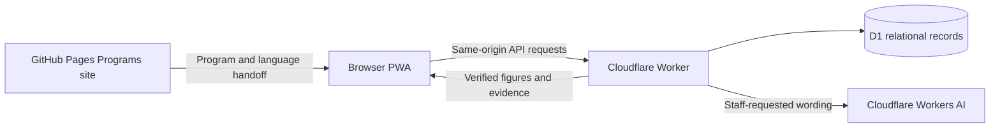

# Architecture and data flow

## Runtime

The frontend is plain HTML, CSS and JavaScript under `public/`. `src/worker.js` owns the API, authorization, attendance, reporting and follow-up logic. `src/imports.js` owns CSV parsing, match suggestions and reviewed imports. Worker assets serve the frontend at the same origin as the API.

For local development, `scripts/dev.mjs` runs those same handlers with `scripts/sqlite.mjs`, a D1-compatible adapter over Node’s built-in SQLite. It has no AI binding and uses labeled templates. Tests run against independent in-memory databases with all migrations applied.

## Records and ownership

| Records | Purpose |
| --- | --- |
| Households, guardians, students, student–guardian links | One family context with distinct children and explicit identity links |
| Programs, groups, enrollments | Service profiles and dated participation; transfer history remains intact |
| Sessions and attendance | Each student’s session status and the session leader’s submission |
| Follow-ups and contact events | Reason, staff owner, due date, next action, attempts, replies and resolution |
| Volunteers, mentor matches and volunteer hours | Assignment history and reviewed contributions |
| Assessments | One start/end reported score per child and program, with date |
| Import records | Stable source system/row ID mapped to a confirmed guardian and child |
| Staff, auth sessions and audit log | Access control and change history |

The seed has 131 enrollment-period rows but 130 distinct child–program enrollments. A student counts once organization-wide even when attending multiple programs. The fictional 100-child cohort is a subset of the organization’s supplied annual scale, not an annual performance claim.

## Attendance to follow-up

The assigned session leader marks every child and submits once. The API validates ownership, complete statuses and the session version; saves attendance with an audit entry; then checks the follow-up rule. There is no review or approval stage. Corrections use the same submission path.

The automatic rule examines the latest submitted attendance within each regular program. Two consecutive `absent` marks trigger an owned task. Present, late or excused statuses break the unexplained-absence sequence. Cancelled and unsubmitted sessions do not enter the calculation. Optional community events never create absence alerts.

Participant explanations use the same consecutive-absence calculation. An existing open task suppresses duplicate tasks for that child/program. Managers can create a manual task for a separate concern, including a pattern across programs. A message attempt does not resolve a concern; staff record resolution explicitly. Absence-triggered family tasks are created on attendance submission. A separate daily check refreshes persistent in-app reminders for overdue attendance and existing follow-ups. It does not send messages or create duplicate family tasks.

Managers can edit a guardian’s shared name, email, phone and preferred language from any linked participant profile. The API checks an expected contact fingerprint, conditionally updates the record and writes before/after values to the audit log in one transaction. Existing child links are unchanged; future message drafts read the updated contact.

## CSV identity review

CSV preview is read-only. Clearly new rows are prepared for creation automatically; identical guardian details within the CSV share one new family and exact repeated child details share one child. Email, phone, guardian-name and child-name similarities to existing records or conflicting CSV rows require review. Managers explicitly confirm those existing identities or choose new records. The server recomputes automatic decisions against current records and checks explicit choices again at import time.

A batch transaction writes new identities, enrollment, eligible future attendance entries, source mappings and audit records. It preserves existing profile fields and submitted historical attendance. The `(source_system, source_id)` key prevents importing the same source row twice. A stored fingerprint detects changed contents under a reused source ID and blocks silent overwrites. Batches are limited to 20 rows / 20 KB; bulk writes limit database calls.

This is signup ingestion with confirmed links. It does not collapse two existing profiles, fetch Google Sheets or migrate historical attendance.

## Outcomes and quarterly evidence

Managers record voluntary 1–5 start/end self-assessments for enrolled mentoring/workshop participants. An end requires a start; dates must be ordered and within the configured quarter. Corrections require confirmation and a current expected value; audit records retain the prior value.

Report numbers come from database records. The regular attendance rate is `(present + late) / (present + late + unexplained absent)` for submitted regular sessions. Optional events, excused absences, cancelled sessions and unsubmitted attendance are excluded from that rate. Event check-ins remain visible in recorded visits. Only approved volunteer hours contribute to the approved-hours total.

Assessment reporting pairs start/end records and discloses missing end responses. Score change is descriptive non-clinical feedback, not causal evidence of effectiveness. Reports show source records, download JSON evidence and print to PDF. The quarter is configured in seeded settings; the quarter-close flow saves dated report snapshots with frozen source records, checklist gaps and staff disclosure notes.

## AI boundary

Workers AI drafts guardian messages and qualitative report notes when staff request them. It does not calculate totals, choose identity matches or run the attendance rule. Report numeric sections are assembled in code; generated notes containing digits fall back to a verified template. Staff must still review qualitative claims. Failed or missing AI calls return a clearly labeled template.

## Access and system boundaries

Opaque expiring HttpOnly cookies identify staff sessions. The API restricts session leaders to their assigned attendance groups and reserves family data, imports, assessments, reports and manual concerns for managers. Same-origin request checks protect mutations; public registration does not reveal existing identities.

The app stores program coordination records only. Secure counseling, donor CRM and financial systems remain external. Shared demo passwords, synthetic data, partial localization, no offline attendance sync, and in-app reminders without outbound notifications are explicit prototype boundaries.

## Weekly brief and quarter close

`src/operations.js` builds a live seven-day action brief using the configured demo date (September 24) in demo mode, or the current UTC day otherwise. Counts distinguish families, concerns, unsubmitted sessions, overdue work, missing end responses and pending contributions. Household links prevent two siblings from being counted as two families. Session leaders own missing-attendance actions; managers own review and outcome-entry actions.

A Cloudflare Cron Trigger runs at `0 13 * * *` (13:00 UTC daily). The same routine is available through the manager-only **Run weekly check** button. It upserts one persistent reminder per overdue session or family task, resolves reminders whose source work is no longer overdue, and records the check time and source. No email, SMS or WhatsApp messages are sent. The local Node preview has no scheduler; its button exercises the same routine.

Quarter close checks all period attendance, pending volunteer contributions, missing end responses and open concerns due by period end. Staff must review the checklist and explain remaining gaps. Saving before period end produces a provisional snapshot; at/after period end, a complete checklist produces an issued report and unresolved work produces an issued report with disclosed gaps. Saving a report does not complete the underlying work.

Snapshots include a deterministic narrative, the computed report, raw source records, readiness details, staff notes, reviewer and save time. An expected fingerprint rejects a stale review. Identical retries return the original version. SQL triggers reject updates/deletes; the app exposes read/create endpoints only. Later corrections require a new version. The explicit guarded disposable-demo reset is the documented exception that removes the rehearsal archive.
